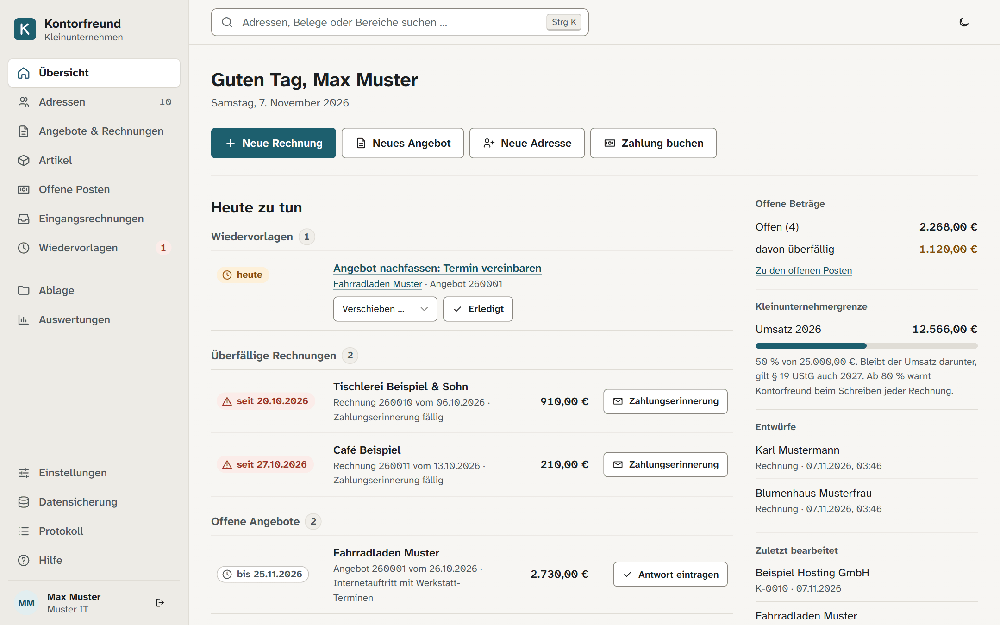
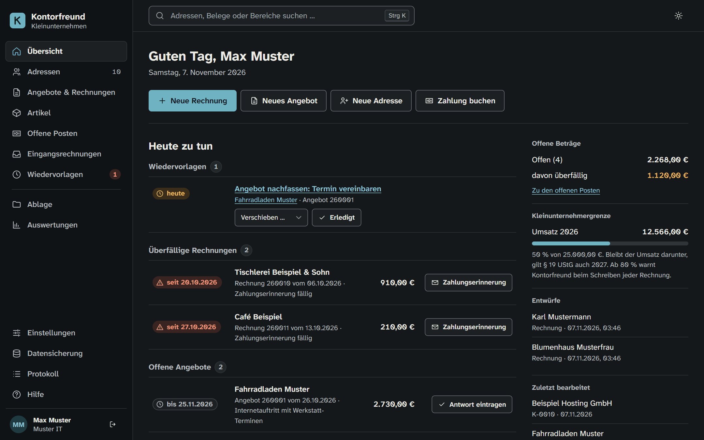
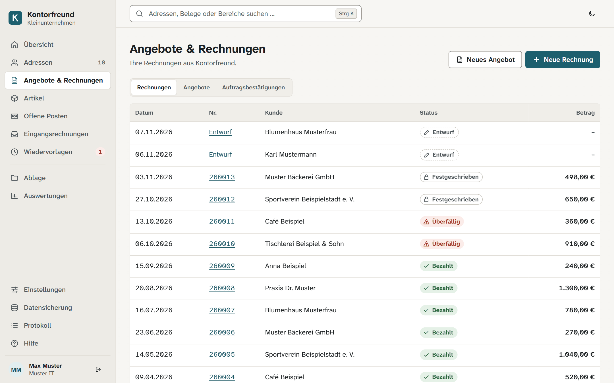
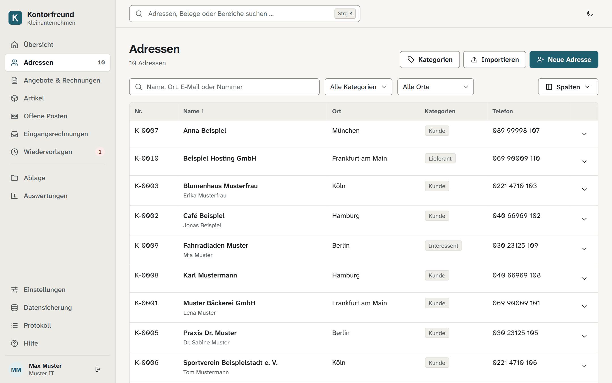
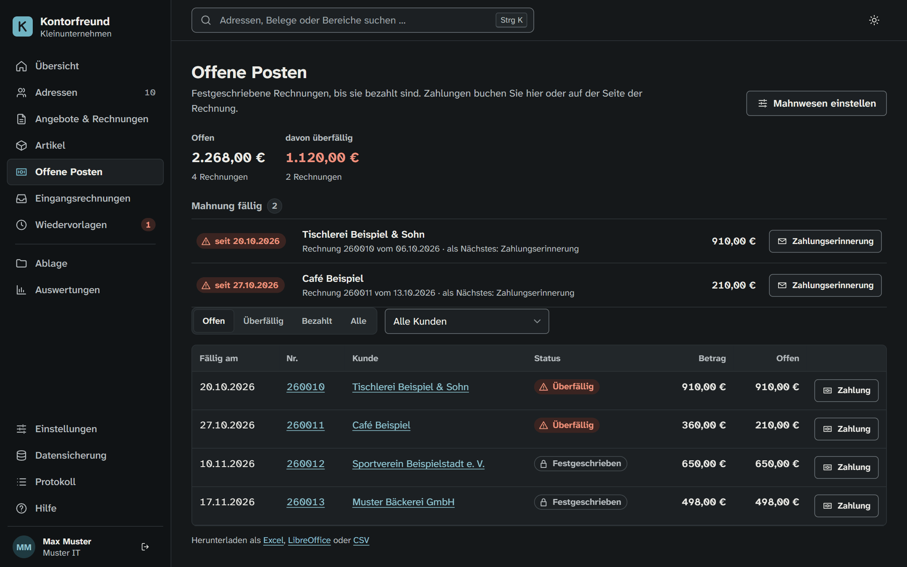
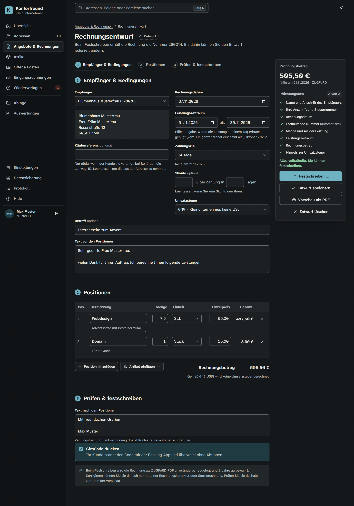
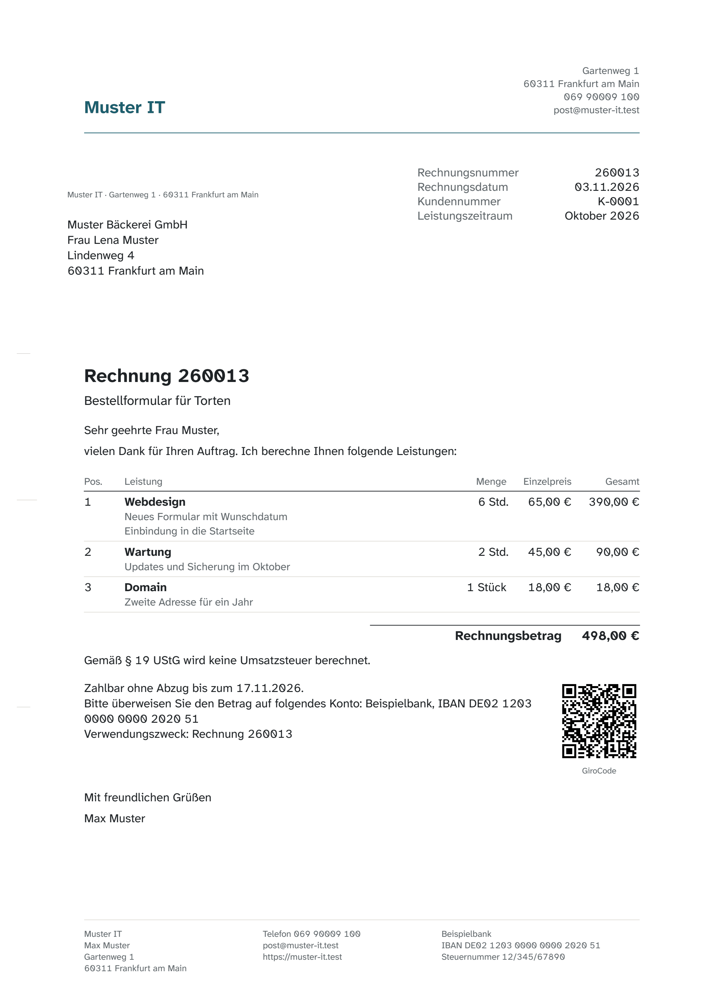

# Kontorfreund (Kleinunternehmen)

Open-Source-CRM und Rechnungsprogramm für Kleinunternehmer und kleine Büros in Deutschland: Kontakte, Wiedervorlagen, Angebote und Rechnungen mit E-Rechnung (XRechnung, ZUGFeRD), offene Posten, Mahnwesen und DATEV-Export.

- Bedienung im Browser – läuft auf Linux, macOS und Windows, ohne Microsoft Office
- Ihre Daten bleiben bei Ihnen: keine Werbung, kein Tracking, keine externen Dienste
- Datenschutz (DSGVO) und GoBD von Anfang an eingebaut



**Status:** frühe Entwicklung, Version 0.41.0. Im Einsatz sind Adressen mit Ansprechpartnern, eigenen Kategorien, mehreren Anschriften, Telefonnummern und E-Mail-Adressen, Verlauf, Dateien und Wiedervorlagen samt Erinnerung über Telegram, Auskunft, Löschen und Sperren nach der DSGVO, Artikel, Angebote, Auftragsbestätigungen und Rechnungen mit ZUGFeRD und XRechnung, Stornorechnung und Rechnungskorrektur, offene Posten mit Zahlungen und Mahnungen samt Verzugszinsen, Eingangsrechnungen, das Rechnungsausgangsbuch, Export von Adressen, offenen Posten und Rechnungsausgangsbuch als CSV, Excel und LibreOffice, Import von Adressen und Artikeln aus diesen Formaten mit Probelauf, der DATEV-Export für den Steuerberater, das Datenpaket für die Betriebsprüfung (Datenträgerüberlassung nach § 147 Abs. 6 AO) und ein Zugang für den Prüfer, der nur lesen kann und von selbst abläuft, die Ablage übernommener Altbelege mit täglicher Prüfung aller abgelegten Belege und jährlichem Vorschlag, abgelaufene Belege zu löschen, Anmeldung, verschlüsselte Datensicherung, ein Gesamtexport aller Daten und Belege, der ohne Kontorfreund lesbar bleibt, die Verfahrensdokumentation nach den GoBD und das Verzeichnis von Verarbeitungstätigkeiten nach der DSGVO, deren Teil zum Programm Kontorfreund selbst schreibt, mehrere Firmen mit getrennten Daten, ein frei gestaltbarer Briefkopf mit Logo oder eigenem Kopfbild und auf Wunsch ein Hinweis auf neue Versionen. Was sich geändert hat, steht in [CHANGELOG.md](CHANGELOG.md), was noch entsteht, in der [Spezifikation](docs/spec/README.md).

## So sieht es aus

Alle Bilder zeigen erfundene Beispieldaten. Kontorfreund richtet sich hell oder dunkel nach Ihrem System, oben rechts können Sie umschalten.

| Übersicht im dunklen Design | Angebote und Rechnungen |
|---|---|
|  |  |

| Adressen | Offene Posten |
|---|---|
|  |  |

| Rechnung schreiben | Fertige Rechnung als PDF |
|---|---|
|  |  |

## Installation

Aktuelle Version direkt laden: [Windows](https://github.com/Reimann-IT-Web/kontorfreund/releases/latest/download/Kontorfreund-Setup.exe), [Windows portabel](https://github.com/Reimann-IT-Web/kontorfreund/releases/latest/download/Kontorfreund-windows-portabel.zip), [macOS mit Apple-Chip](https://github.com/Reimann-IT-Web/kontorfreund/releases/latest/download/Kontorfreund-macos-arm64.tar.gz), [Linux](https://github.com/Reimann-IT-Web/kontorfreund/releases/latest/download/Kontorfreund-linux-x86_64.tar.gz). Ältere Versionen und die Stückliste (SBOM) hängen am jeweiligen [Release](../../releases).

- **Windows:** `Kontorfreund-Setup.exe` ausführen. Das Programm kommt nach `C:\Program Files\Kontorfreund`, einen anderen Ordner können Sie auf der ersten Seite wählen; dafür fragt Windows nach Administratorrechten. Weil das Programm noch nicht signiert ist, warnt Windows beim ersten Mal („Der Computer wurde durch Windows geschützt“): „Weitere Informationen“ und dann „Trotzdem ausführen“ wählen.
- **Windows ohne Installation (portabel):** `Kontorfreund-windows-portabel.zip` entpacken, etwa auf einen USB-Stick, und im Ordner `Kontorfreund` die Datei `Kontorfreund.exe` starten; Administratorrechte braucht das nicht. Die Daten liegen dann im Ordner `Daten` neben dem Programm, solange dort auch `portabel.txt` liegt. Die portable Fassung läuft unter http://127.0.0.1:8766/, damit sie sich nie mit einer installierten vermischt, und startet nicht beim Anmelden an Windows. Für ein Update die neue Fassung in einen neuen Ordner entpacken und den Ordner `Daten` hineinverschieben. Auf einem USB-Stick liegen die Daten unverschlüsselt; verschlüsseln Sie ihn, etwa mit BitLocker To Go.
- **macOS und Linux:** Archiv entpacken und `Kontorfreund/Kontorfreund` starten.

Kontorfreund öffnet sich im Browser unter http://127.0.0.1:8765/. Das kleine Fenster dazu bleibt offen, solange Sie arbeiten; schließen beendet das Programm. Ihre Daten liegen getrennt vom Programm:

| System | Ordner |
|---|---|
| Windows | `%LOCALAPPDATA%\Kontorfreund` |
| macOS | `~/Library/Application Support/Kontorfreund` |
| Linux | `~/.local/share/Kontorfreund` bzw. `$XDG_DATA_HOME/Kontorfreund` |

Jede weitere Firma (Einstellungen → Firmen) bekommt dort einen eigenen Unterordner `firmen/2`, `firmen/3` und so weiter.

Für ein Update installieren Sie die neue Version einfach darüber; Windows fragt auch dabei nach Ihrer Bestätigung. Die Datenbank wird beim nächsten Start angepasst, vorher entsteht eine Sicherung. Beim Deinstallieren bleiben die Daten erhalten.

**Zugang verloren?** Nach fünf falschen Kennwörtern oder Codes ist ein Konto 15 Minuten gesperrt, danach geht es wieder. Konten von Mitarbeitern entsperrt der Inhaber unter Einstellungen → Benutzer; dort setzt er auch ein vergessenes Kennwort neu. Für den Inhaber selbst gibt es zwei Befehle, unter Windows in der Eingabeaufforderung im Programmordner (`C:\Program Files\Kontorfreund`):

- `Kontorfreund changepassword <E-Mail>` setzt ein neues Kennwort.
- `Kontorfreund entsperren <E-Mail> --ohne-zwei-faktor` hebt die Sperre auf und schaltet die Zwei-Faktor-Anmeldung aus, etwa wenn das Telefon verloren ist. Ohne `--ohne-zwei-faktor` hebt er nur die Sperre auf.

## Entwicklung

Voraussetzung: [uv](https://docs.astral.sh/uv/). Python 3.12 lädt uv bei Bedarf selbst.

```sh
uv sync
uv run python manage.py migrate
APP_DEBUG=1 uv run python manage.py runserver
```

Danach läuft das Programm unter http://localhost:8000.

```sh
uv run pytest                     # Tests
uv run ruff check . && uv run ruff format .
```

Installationspaket bauen (auf dem jeweiligen System):

```sh
uv sync --group paket
uv run pyinstaller packaging/kontorfreund.spec --noconfirm
dist/Kontorfreund/Kontorfreund selbsttest
```

Ein Tag `v<Version>` baut über `.github/workflows/paket.yml` die Pakete für alle drei Systeme und legt das Release an.

## Lizenz

Copyright © 2026 Reimann IT & Web.

[AGPL-3.0-only](LICENSE). Eine kommerzielle Lizenz ohne AGPL-Pflichten ist geplant.

Die Orte zu den Postleitzahlen (`contacts/daten/plz.tsv`) stammen aus [OpenPLZ](https://github.com/openpotato/openplzapi.data) und damit aus OpenStreetMap, © OpenStreetMap-Mitwirkende, unter der [Open Database License 1.0](https://opendatacommons.org/licenses/odbl/1-0/); die Datei steht unter derselben Lizenz. Die Schrift Atkinson Hyperlegible Next steht unter der SIL Open Font License (`invoicing/schrift/`). Die Datei `auswertungen/daten/gdpdu-01-08-2002.dtd` ist die Dokumenttyp-Definition des „Beschreibungsstandards für die Datenträgerüberlassung“ der Finanzverwaltung (entwickelt mit der Audicon GmbH, heute CaseWare); sie liegt unverändert jedem Datenpaket bei, wie der Standard es verlangt.

Sicherheitslücken bitte vertraulich melden, siehe [SECURITY.md](SECURITY.md). Wie Kontorfreund die Anforderungen von OWASP ASVS Stufe 2 erfüllt, steht in [docs/sicherheit.md](docs/sicherheit.md). Die Liste bekannter Kennwörter aus Datenlecks (`konten/daten/kennwoerter.txt`) stammt aus [SecLists](https://github.com/danielmiessler/SecLists), MIT-Lizenz (`konten/daten/SecLists-LICENSE.txt`).
